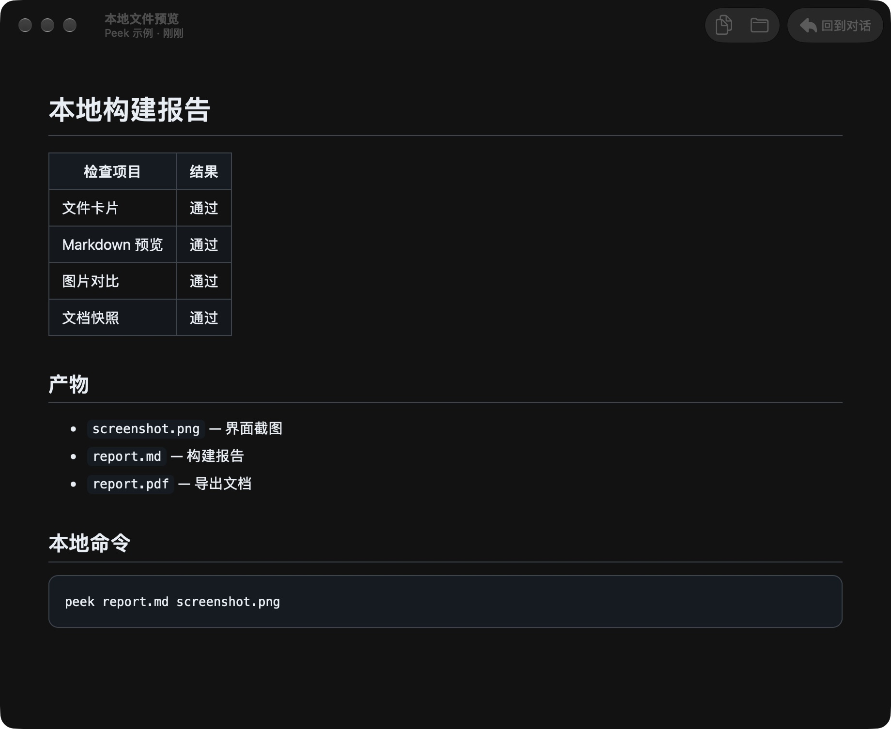
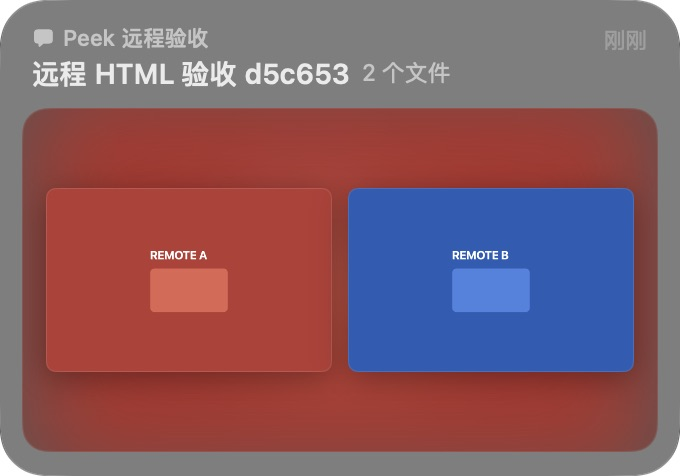
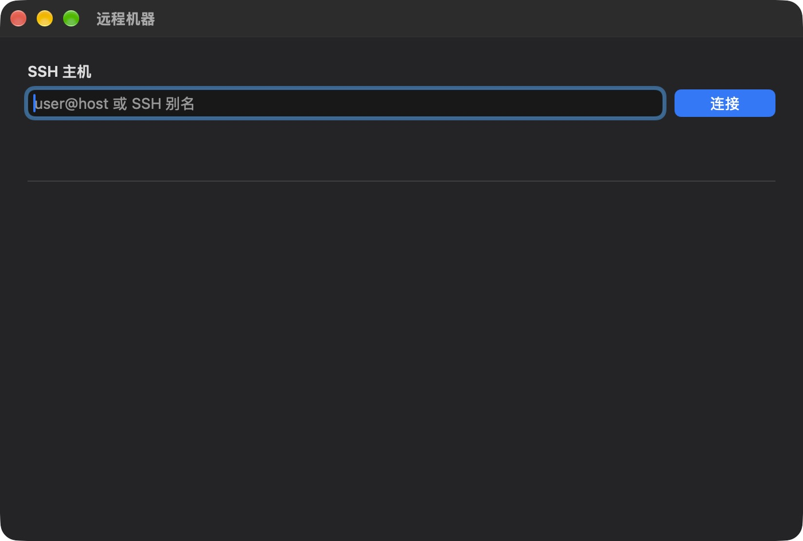

# Peek

在 Mac 上用浮动卡片预览图片、PDF、Markdown 和 HTML，点击卡片后再打开查看器。**本地使用和远程使用是两个独立入口**，都可以脱离 Rex 和 AI agent 使用。

[下载 Mac 通用版](https://github.com/terryops/peek/releases/latest) · macOS 26+ · 已签名、公证

## 本地使用

直接预览本机文件，无需配置 SSH。

```sh
peek report.md screenshot.png
peek -t "设计对比" before.png after.png
```

[本地命令安装与用法](docs/local-usage.md)



## 远程使用

Mac 菜单栏 →「远程机器…」→ 连接 SSH 主机 → 拷贝发送命令，在远端加上文件路径即可推回本机。

远端支持 Linux / macOS，沿用现有 SSH 配置；HTML / Markdown 的本地资源随文件发送。无需中继服务。



<details>
<summary>远程连接窗口</summary>



</details>

[远程配置与限制](docs/remote-forwarding.md)

## 开发

需要 Swift 6.2+、Go 1.24+。

```sh
./Scripts/install.sh
swift test
(cd Remote && go test ./...)
```

[MIT License](LICENSE) · [第三方许可](THIRD_PARTY_NOTICES.md)
