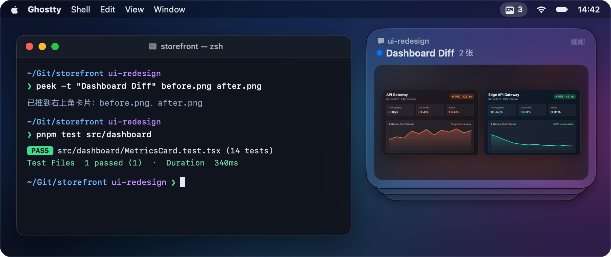
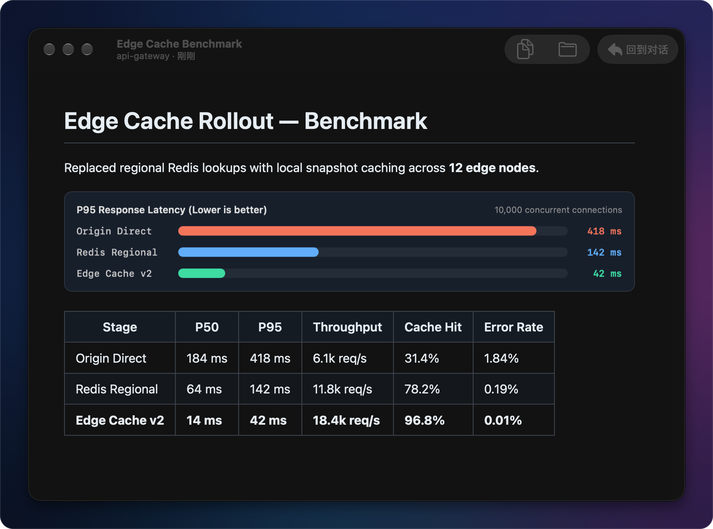

# Peek

English · [简体中文](README.zh-CN.md)

Native macOS file previews for terminal, SSH, and AI agent workflows. Incoming **images, PDFs, Markdown, and HTML** appear as non-activating floating cards in the top-right corner of your screen—click a card when you are ready to inspect it in Peek's built-in viewer, and press `Esc` to return right where you were typing.

[**Download Universal Mac App**](https://github.com/terryops/peek/releases/latest) · macOS 26+ (Apple Silicon & Intel) · Signed & Notarized · [MIT License](LICENSE)

<p align="center">
  
</p>

## Why Peek

- **Never steals focus** — Floating cards stay above all Spaces and full-screen apps without interrupting your active window. Peek runs in the menu bar with no Dock icon, and closing the viewer hands focus straight back.
- **Self-contained snapshots** — Local files are cloned instantly on APFS with zero extra disk space. Relative CSS, JS, and images referenced by Markdown or HTML are bundled with the card, so overwriting a screenshot or build report later never alters an earlier preview.
- **Zero-relay SSH forwarding** — Push files from remote Linux or macOS machines (`amd64` / `arm64`) over your existing `/usr/bin/ssh` setup (`~/.ssh/config`, keys, agent, JumpHosts). No accounts, cloud relays, or inbound ports on your Mac.
- **Standalone or agent-ready** — Local CLI and SSH forwarding work independently out of the box, and integrate cleanly with scripts, terminals, and AI coding agents.

## Install

1. Download `Peek-universal.zip` from [GitHub Releases](https://github.com/terryops/peek/releases/latest), move `Peek.app` into `/Applications`, and open it.
2. *(Optional, for local CLI)* Link `peek` onto your `PATH`:

```sh
mkdir -p "$HOME/bin"
ln -sfn "/Applications/Peek.app/Contents/MacOS/Peek" "$HOME/bin/peek"
```

Ensure `$HOME/bin` is in your shell `PATH` (for example, `export PATH="$HOME/bin:$PATH"` in `~/.zprofile`).

## Quick Start

### Local CLI

Preview local files directly without any SSH setup:

```sh
peek screenshot.png
peek report.md
peek -t "Design diff" before.png after.png    # multiple files become one card
peek -c "CI" -t "Build Report" report.html    # custom source label and card title
peek --list                                   # list cards from the last 24h
peek --clear                                  # remove all cards and cached snapshots
```

When `-t` is omitted, single-file cards automatically use `<title>` for HTML, the first `# ` heading for Markdown, or the filename. Full details: [docs/local-usage.md](docs/local-usage.md).

<p align="center">
  
</p>

### Remote over SSH

Push files generated on remote servers straight to your Mac:

1. Click the Peek menu bar icon → **远程机器…** (*Remote Machines*), or run `peek --remote-settings`.
2. Enter an SSH alias or `user@host` and click **连接** (*Connect*). Unknown host fingerprints and passwords use native macOS verification dialogs; passwords are never stored.
3. Click **拷贝命令** (*Copy Command*), paste it on the remote machine, and append file paths:

```sh
'/home/me/.local/bin/peek' --to '<target-uuid>' report.html chart.png
```

When only one Mac is connected to that remote host, `peek report.html` works without `--to`. Local assets referenced by HTML and Markdown are transferred together (up to 300 files / 64 MiB per push), and received originals are saved to `~/Downloads/Peek/<host>/`. Full details and protocol limits: [docs/remote-forwarding.md](docs/remote-forwarding.md).

### AI Agents & Claude Code

- **Any agent or script**: Call `peek <files…>` instead of `open` so generated charts, diffs, PDFs, and reports appear as cards without hijacking focus.
- **Claude Code hook** *(optional)*: Configure [`Resources/hooks/session-start.sh`](Resources/hooks/session-start.sh) as a `SessionStart` hook (expects `~/Applications/Peek.app`, as installed by `./Scripts/install.sh`). Inside Claude Code Bash sessions, `open *.png/*.pdf/*.md/*.html`, `open -a Preview …`, and `qlmanage -p …` are transparently routed to Peek cards, while URLs, folders, `open -R`, and other apps pass straight to `/usr/bin/open`. Set `PEEK_OFF=1` to bypass.

## Cards & Viewer

<p align="center">
  
</p>

- **Card interactions** — Click to open · `⌥`-Click to reveal in Finder · Drag files directly off a card into other apps · Two-finger swipe right to dismiss · Right-click for context actions.
- **Styles & layout** — Switch between *Rich*, *Compact*, and *Photo* card styles, stacked deck or vertical list, and edge tucking from the menu bar.
- **Lifecycle** — Unread cards stay until opened; viewed cards auto-dismiss after 5 minutes of inactivity (up to 3 visible at once, extras queued). Cached snapshots in `~/Library/Caches/Peek/` expire after 24 hours.
- **Built-in viewer** — Side-by-side image comparison (`⌘D`, enabled by default when opening multiple images on an external display), 1:1 pixel / fit zoom, continuous `PDFKit` view, GFM Markdown via `marked`, and sandboxed `WKWebView` for HTML (external links open in your default browser).

## Shortcuts

Global shortcuts use Carbon hotkeys and require no Accessibility permission. Customize or disable (`""`) via `defaults write com.terryops.peek <key> "<combo>"` (`hotkeyOpen`, `hotkeyTuck`, `hotkeyCloseAll`).

| Shortcut | Scope | Action |
| --- | --- | --- |
| `⌃⌥P` | Global | Open or close newest card |
| `⌃⌥H` | Global | Tuck or restore card stack |
| `⌃⌥X` | Global | Dismiss all cards |
| `⎋` / `Space` | Viewer | Close viewer (keep card) |
| `⌘W` / `⌘⌫` | Viewer | Close viewer and dismiss card |
| `←` `→` / Swipe | Viewer | Previous / next file in card |
| `↑` `↓` | Viewer | Previous / next card |
| `⌘D` | Viewer | Toggle side-by-side comparison |
| `⌘0` / `⌘1` / `⌘±` | Viewer | Fit to window / 1:1 pixels / zoom |
| `⌘C` / `⌘R` / `↩` | Viewer | Copy / reveal in Finder / back to conversation |
| `?` | Viewer | Toggle shortcut cheat sheet |

## Build from Source

Requires macOS 26+, Swift 6.2+ (Xcode), and Go 1.24+ (builds the dependency-free `peek-remote` helper for `darwin` & `linux` on `amd64` & `arm64`).

```sh
./Scripts/install.sh          # build, self-test, install ~/Applications/Peek.app + LaunchAgent + ~/bin/peek
./Scripts/build.sh            # build build/Peek.app only (set PEEK_UNIVERSAL=1 for arm64 + x86_64)
swift test
(cd Remote && go test -race ./...)
```

## License

[MIT License](LICENSE) · [Third-Party Notices](THIRD_PARTY_NOTICES.md)
