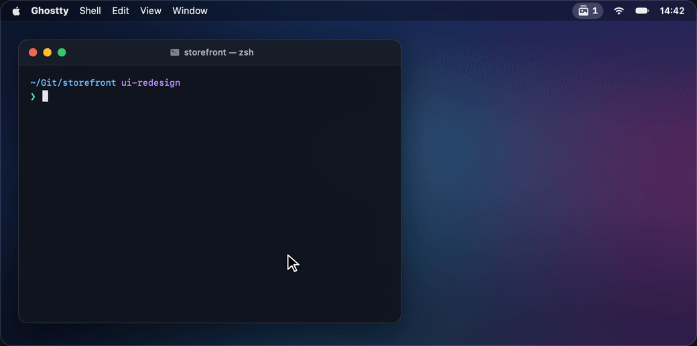

# Peek

[English](README.md) · 简体中文 · [手动使用与快捷键](docs/manual-usage.zh-CN.md)

专为 AI Agent（Claude Code、Codex、Cursor、Windsurf、OpenClaw 等）设计的原生 macOS 浮动预览卡片。Agent 生成的**图片、PDF、Markdown 和 HTML** 不再弹起 Preview 或浏览器抢走你的键盘焦点，也不用去聊天记录里翻裸路径，而是安静推到屏幕右上角的不抢焦点卡片——想看时点击卡片在内置查看器中打开，按 `Esc` 立即回到原窗口继续输入，按 `↩` 直接切回发出这张卡片的对话。

[**下载 Mac 通用版**](https://github.com/terryops/peek/releases/latest) · macOS 14+（Apple Silicon / Intel）· 已签名与公证 · [MIT License](LICENSE)

<p align="center">
  
</p>

## 1. 一次性准备

### 在本机 Mac 上

1. 从 [GitHub Releases](https://github.com/terryops/peek/releases/latest) 下载 `Peek-universal.zip`，解压后将 `Peek.app` 拖入「应用程序」并打开。
2. 点击菜单栏 Peek 图标 →「安装 peek 命令」（并可勾选「登录时打开」），或在终端手动创建软链接：

```sh
mkdir -p "$HOME/bin"
ln -sfn "/Applications/Peek.app/Contents/MacOS/Peek" "$HOME/bin/peek"
```

请确保 `$HOME/bin` 已加入 `PATH`（例如在 `~/.zprofile` 中添加 `export PATH="$HOME/bin:$PATH"`）。

### 在远程 SSH 服务器上 *（可选）*

如果 Agent 跑在远程 Linux 或 macOS 服务器（`amd64` / `arm64`）上，点击菜单栏 Peek 图标 →「远程机器…」，输入 SSH 别名、`user@host` 或 `user@host:port` 并点击「连接」。Peek 会直接复用系统 `/usr/bin/ssh`（沿用 `~/.ssh/config`、密钥、SSH agent 与跳板机）在远端安装 `~/.local/bin/peek`，无需任何云端中继或开放入站端口，远端 Agent 即可把文件直接推回当前 Mac。

## 2. 写入全局规则（`CLAUDE.md` / `AGENTS.md`）

将以下规则贴入 `~/.claude/CLAUDE.md`、`AGENTS.md` 或编辑器的全局规则（本机与已连接的远程 SSH 服务器通用）：

```markdown
## 预览交付（`peek`）

凡是需要我查看的截图、UI 前后对比图、图表、PDF 或 Markdown / HTML 报告，统一用 `peek` 推到屏幕右上角浮动卡片：

- 执行 `peek -t "简短标题" <文件…>`（远程 SSH 主机若未将 `~/.local/bin` 加入 `PATH`，执行 `~/.local/bin/peek -t "简短标题" <文件…>`）。
- 相关的多张图片（如修改前后对比、多方案效果图）放在同一条 `peek` 命令里合推成一张卡，方便并排对比。
- Markdown / HTML 引用的本地图片、CSS、JS 使用同目录下的相对路径，`peek` 会随卡片自动快照打包，后续覆盖同名文件不会影响旧卡片。
- 不要对预览文件直接执行 `open` 或 `qlmanage -p`（会抢走当前焦点），也不要只丢文件路径而不推卡片。
```

## 3. Agent 调用速查

```sh
# 推送 Markdown 或 HTML 报告（同目录下引用的本地图表、CSS、JS 会随卡片自动打包）
peek -t "鉴权耗时排查报告" report.md

# 将修改前后多张截图放在同一条命令里合推，点开即可并排对比
peek -t "结账页顶栏对比" before.png after.png

# 多子 Agent 或后台任务并行时，显式指定卡片顶部的来源名称
peek -c "UI Subagent" -t "深色模式检查" settings-dark.png

# 远程 SSH Agent（仅在多台 Mac 同时连同一台服务器时需加 --to；单台 Mac 可直接省略）
~/.local/bin/peek -t "评测报告" --to "<接收端UUID>" report.html
```

- **支持格式** — 图片（`png`、`jpg`、`webp`、`gif`、`svg`、`heic`、`avif`、`tiff`、`bmp`）、`pdf`、`md`（GFM Markdown）与 `html`（沙盒化 `WKWebView`，外部网页链接通过默认浏览器打开）。
- **参数位置自由** — 本机 `peek` 与远端 SSH `peek` 均支持短参数（`-t`、`-c`、`-s`）和长参数（`--title`、`--conversation`、`--source`、`--flag=value`），放在文件路径前后均可（`--` 之后视为纯路径）。省略 `-t` 时，单文件卡片自动提取 HTML `<title>`、Markdown 首个 `# ` 标题或文件名。
- **反复覆盖原路径也不串改** — 本机文件通过 APFS 克隆瞬间生成独立快照，不占额外磁盘空间；远端推送自动附带最多 300 个本地引用资源（上限 64 MiB），并将原文件存至 `~/Downloads/Peek/<主机>/<时间>_<标题>_<短ID>/`。Agent 在多轮迭代中直接覆盖 `/tmp/check.png` 或 `build/report.md` 也不会影响之前推过的卡片。
- **多 Agent 自动标注来源与「回到对话」（`↩`）** — 本机并行跑多个会话时，卡片顶部会自动识别并标注来源会话（优先取 Claude Code `/rename` 名称、Rex 窗格名或首句 Prompt）。查看卡片时按 `↩` 或点击「回到对话」，即可直接切回发出该卡片的终端或窗格。

<p align="center">
  
</p>

<p align="center">
  
</p>

## 4. 可选：Claude Code 自动拦截 `open`

如果某个 Agent 或子 Agent 仍习惯性执行 `open screenshot.png`、`open -a Preview …` 或 `qlmanage -p …`，可将 [`session-start.sh`](Resources/hooks/session-start.sh) 加入 `~/.claude/settings.json` 的 `SessionStart` hook。Claude Code Bash 会话中针对可预览文件的打开命令会自动转为 Peek 卡片，而网址、文件夹、`open -R` 及其他指定应用仍原样交给系统 `/usr/bin/open`（设 `PEEK_OFF=1` 可临时绕过）：

```json
{
  "hooks": {
    "SessionStart": [
      {
        "hooks": [
          {
            "type": "command",
            "command": "/bin/sh -c 'for app in /Applications/Peek.app \"$HOME/Applications/Peek.app\"; do [ -x \"$app/Contents/Resources/hooks/session-start.sh\" ] && exec \"$app/Contents/Resources/hooks/session-start.sh\"; done; exit 0'",
            "timeout": 5
          }
        ]
      }
    ]
  }
}
```

## 手动使用、快捷键与构建指南

如需在终端手动管理卡片（`--list`、`--clear`、`--quit`）、手动配置与发送 SSH 远程文件、了解卡片手势与样式切换、全局及查看器快捷键、`defaults` 参数调整或从源码编译，请参阅 **[手动使用、快捷键与构建指南](docs/manual-usage.zh-CN.md)**。

## 许可

[MIT License](LICENSE) · [第三方许可声明](THIRD_PARTY_NOTICES.md)
