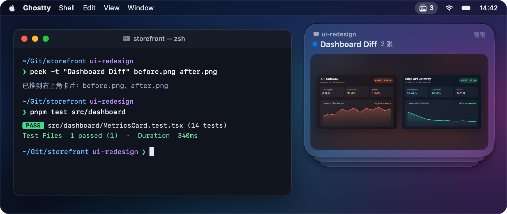
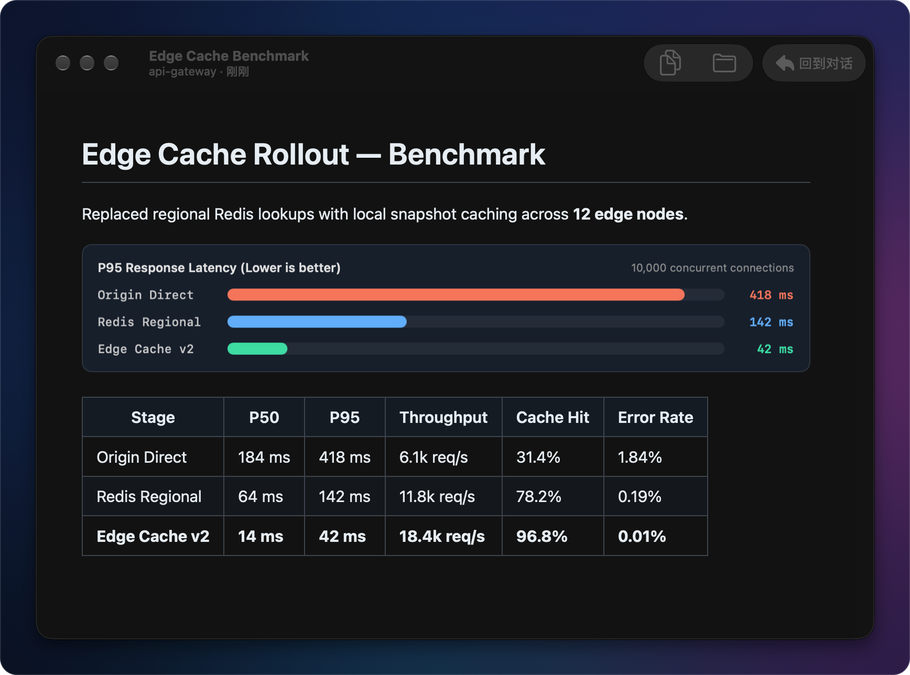
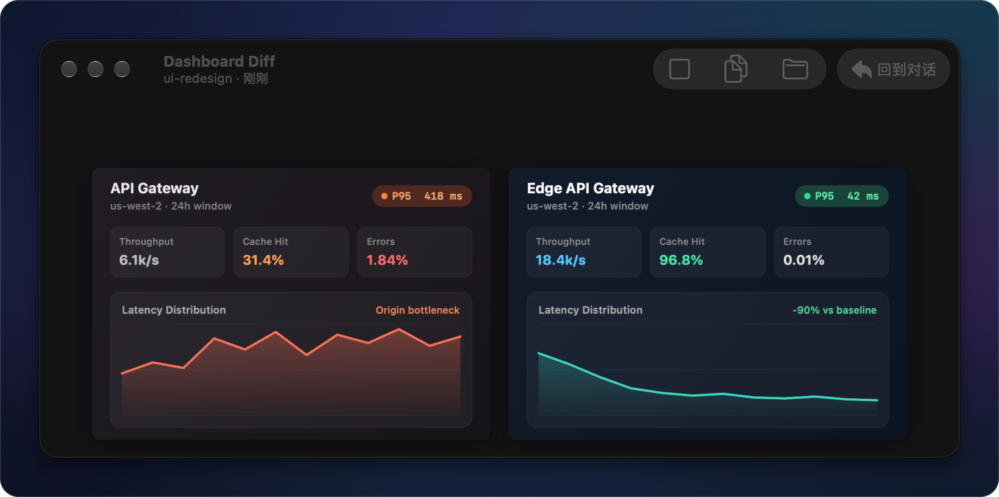

# Peek

[English](README.md) · 简体中文

面向终端、SSH 与 AI Agent 工作流的原生 macOS 文件预览工具。发来的**图片、PDF、Markdown 和 HTML** 先落在屏幕右上角的不抢焦点浮动卡片；想看时点击卡片在自带查看器中打开，按 `Esc` 立即回到原本正在输入的窗口。

[**下载 Mac 通用版**](https://github.com/terryops/peek/releases/latest) · macOS 26+（Apple Silicon / Intel）· 已签名与公证 · [MIT License](LICENSE)

<p align="center">
  
</p>

## 为什么用 Peek

- **不打断当前焦点** — 浮动卡片悬停在所有桌面空间与全屏应用之上，不抢键盘焦点。Peek 常驻菜单栏、无 Dock 图标，关闭查看器后焦点直接回到原来的应用。
- **独立快照不串改** — 本地文件通过 APFS 克隆瞬间生成快照，不占额外磁盘空间；Markdown 与 HTML 引用的本地 CSS、JS、图片随卡片一并打包，后续覆盖同名截图或报告不会影响旧卡片。
- **SSH 零中继回传** — 直接复用系统 `/usr/bin/ssh`（沿用 `~/.ssh/config`、密钥、SSH agent 与跳板机），将远程 Linux / macOS（`amd64` / `arm64`）上的文件推回本机。无需注册账号、中继服务或开放 Mac 入站端口。
- **独立可用，也适配 Agent** — 本地 CLI 与 SSH 远程回传是两个独立入口，可直接在终端或脚本中使用，也可无缝接入 Claude Code 等 AI 编程工具。

## 安装

1. 从 [GitHub Releases](https://github.com/terryops/peek/releases/latest) 下载 `Peek-universal.zip`，解压后将 `Peek.app` 拖入「应用程序」并打开。
2. *（可选，配置本地命令行）* 将 `peek` 链接到 `PATH`：

```sh
mkdir -p "$HOME/bin"
ln -sfn "/Applications/Peek.app/Contents/MacOS/Peek" "$HOME/bin/peek"
```

请确保 `$HOME/bin` 已加入 `PATH`（例如在 `~/.zprofile` 中添加 `export PATH="$HOME/bin:$PATH"`）。

## 快速开始

### 本地命令行

无需任何远程或 SSH 配置，直接预览本机文件：

```sh
peek screenshot.png
peek report.md
peek -t "设计对比" before.png after.png    # 多个文件合并为同一张卡片
peek -c "CI" -t "构建报告" report.html     # 自定义来源名与卡片标题
peek --list                                # 列出 24 小时内的卡片
peek --clear                               # 清空全部卡片与缓存快照
```

未指定 `-t` 时，单文件卡片会自动提取 HTML 的 `<title>`、Markdown 的首个 `# ` 标题或文件名。详见 [本地使用说明](docs/local-usage.md)。

<p align="center">
  
</p>

### SSH 远程发送

把远程服务器生成的文件直接推回当前 Mac：

1. 点击菜单栏 Peek 图标 →「远程机器…」，或执行 `peek --remote-settings`。
2. 输入 SSH 别名或 `user@host`，点击「连接」。首次遇到未知主机指纹或需要密码时弹出系统原生验证框，密码不会落盘保存。
3. 点击「拷贝命令」，粘贴到远程终端并在末尾附上文件路径：

```sh
'/home/me/.local/bin/peek' --to '<接收端UUID>' report.html chart.png
```

同一台远程主机只连了一台 Mac 时可省略 `--to`，直接执行 `peek report.html`。HTML / Markdown 引用的本地资源会随文档一起传输（单次最多 300 个文件、64 MiB），收到的原始文件保存在 `~/Downloads/Peek/<主机>/`。完整配置与协议限制见 [远程文件说明](docs/remote-forwarding.md)。

### AI Agent 与 Claude Code

- **任意 Agent 或脚本**：用 `peek <文件…>` 代替 `open`，生成的对比图、PDF 或测试报告只会安静推到右上角卡片，不会弹窗打断操作。
- **Claude Code 无感集成** *（可选）*：将 [`Resources/hooks/session-start.sh`](Resources/hooks/session-start.sh) 配置为 `SessionStart` hook（需通过 `./Scripts/install.sh` 安装至 `~/Applications/Peek.app`）。配置后，会话内的 `open *.png/*.pdf/*.md/*.html`、`open -a Preview …` 与 `qlmanage -p …` 会自动转为 Peek 卡片；网址、文件夹、`open -R` 及其他应用原样交给 `/usr/bin/open`。设置 `PEEK_OFF=1` 可临时绕过。

## 卡片与查看器

<p align="center">
  
</p>

- **卡片交互** — 点击打开 · `⌥`+点击在访达中显示 · 直接从卡片拖拽文件到其他 App · 双指右滑关闭 · 右键打开快捷菜单。
- **样式与布局** — 菜单栏可切换「大图 / 简洁 / 照片」三种卡片样式、叠放或竖排列表，以及缩进屏幕右边缘暂存。
- **自动生命周期** — 未读卡片常驻保留；已查看卡片静置 5 分钟后自动收起（同屏最多显示 3 张，超出自动排队）。`~/Library/Caches/Peek/` 下的快照满 24 小时自动清理。
- **内置查看器** — 支持多图并排对比（`⌘D`，外接显示器打开多张图片时默认开启）、1:1 像素与适应窗口缩放、PDF 连续滚动、基于 `marked` 的 GFM Markdown 渲染，以及沙盒化的 HTML `WKWebView`（外部链接调用默认浏览器打开）。

## 快捷键

全局快捷键基于 Carbon 注册，无需授予辅助功能权限；可通过 `defaults write com.terryops.peek <键名> "<组合键>"`（`hotkeyOpen`、`hotkeyTuck`、`hotkeyCloseAll`）修改，设为空字符串 `""` 可停用。

| 快捷键 | 范围 | 操作 |
| --- | --- | --- |
| `⌃⌥P` | 全局 | 打开或关闭最新一张卡片 |
| `⌃⌥H` | 全局 | 暂时收起或恢复卡片堆叠 |
| `⌃⌥X` | 全局 | 关闭全部卡片 |
| `⎋` / `Space` | 查看器 | 关闭查看器（保留卡片） |
| `⌘W` / `⌘⌫` | 查看器 | 关闭查看器并收走卡片 |
| `←` `→` / 左右滑 | 查看器 | 切换当前卡片内的文件 |
| `↑` `↓` | 查看器 | 切换上一张 / 下一张卡片 |
| `⌘D` | 查看器 | 切换多图并排对比 |
| `⌘0` / `⌘1` / `⌘±` | 查看器 | 适应窗口 / 原始像素 / 缩放 |
| `⌘C` / `⌘R` / `↩` | 查看器 | 拷贝 / 在访达中显示 / 回到对话 |
| `?` | 查看器 | 显示或隐藏快捷键速查表 |

## 源码构建与测试

构建需要 macOS 26+、Swift 6.2+（Xcode）与 Go 1.24+（用于交叉编译无第三方依赖的 `darwin` / `linux` × `amd64` / `arm64` 远程 helper）。

```sh
./Scripts/install.sh          # 编译、自检并安装 ~/Applications/Peek.app + LaunchAgent + ~/bin/peek
./Scripts/build.sh            # 仅构建 build/Peek.app（设 PEEK_UNIVERSAL=1 构建通用二进制）
swift test
(cd Remote && go test -race ./...)
```

## 许可

[MIT License](LICENSE) · [第三方许可声明](THIRD_PARTY_NOTICES.md)
